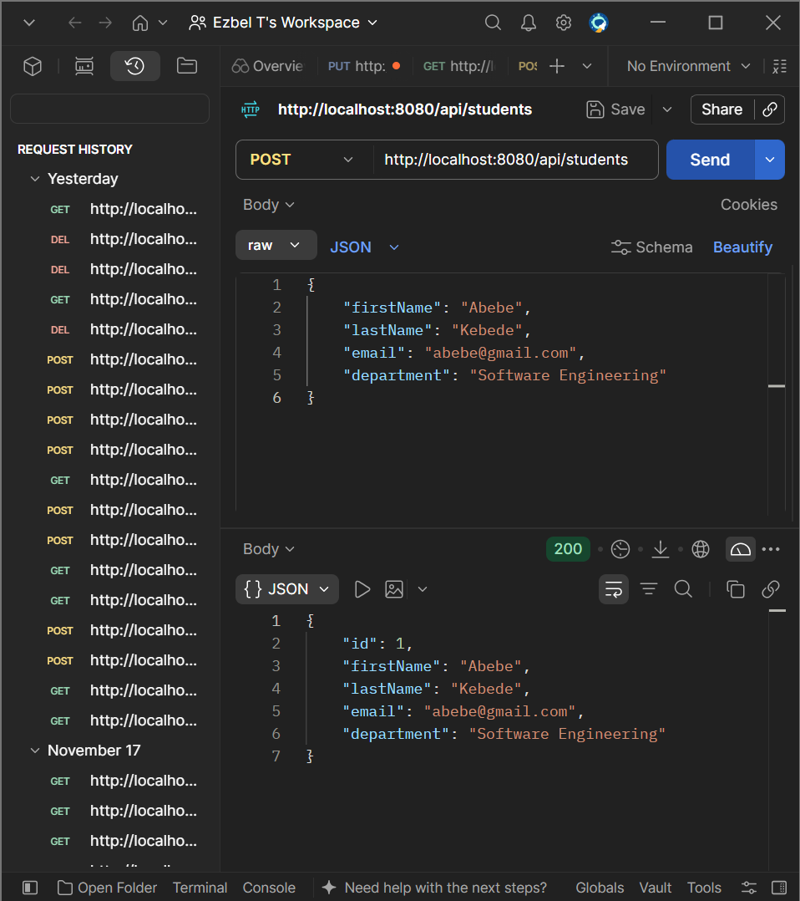
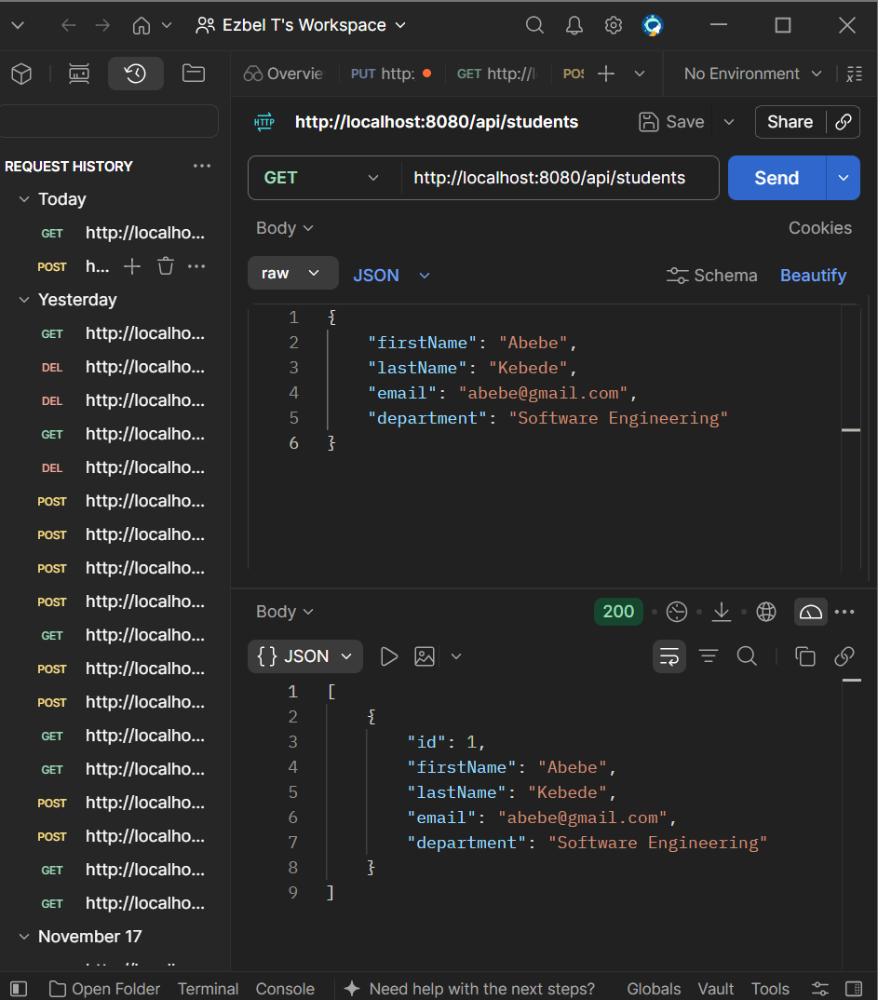
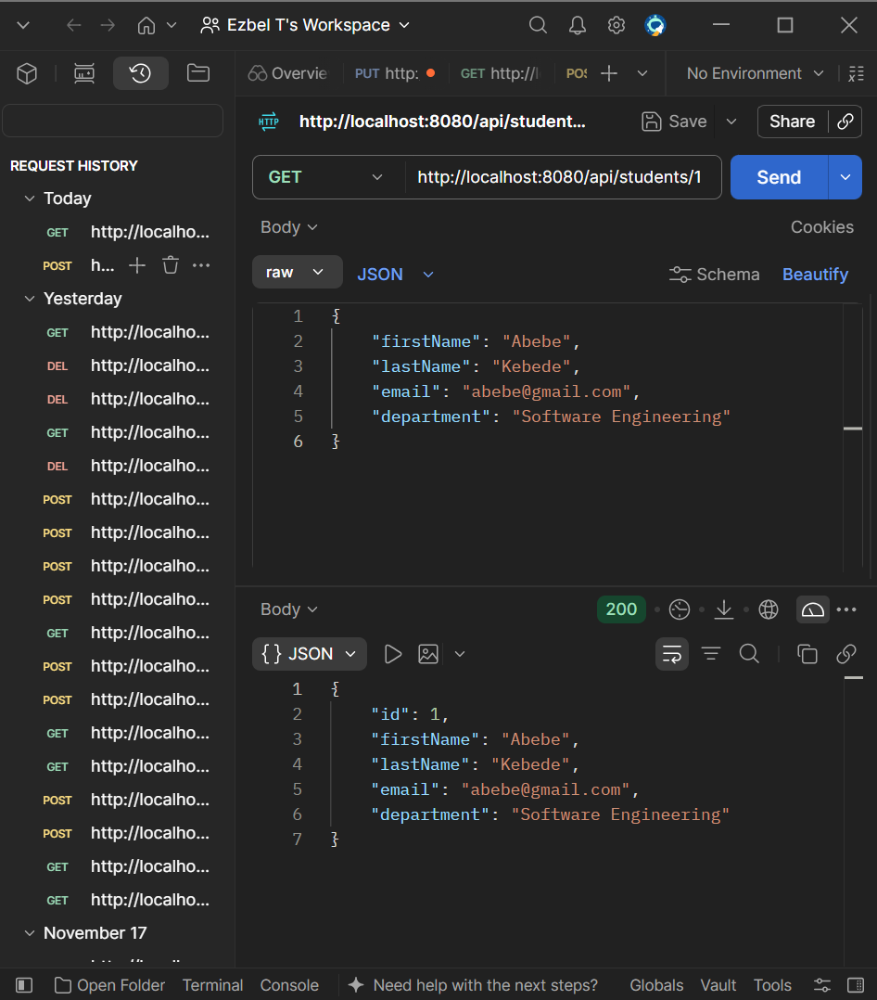
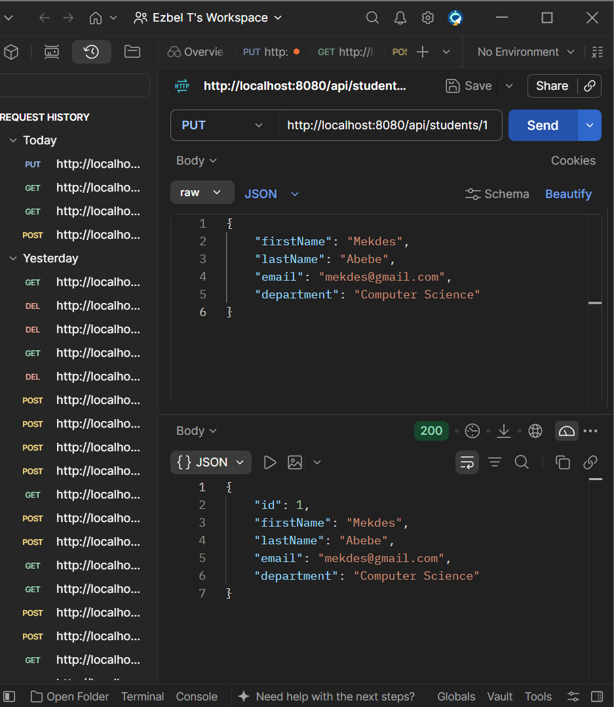
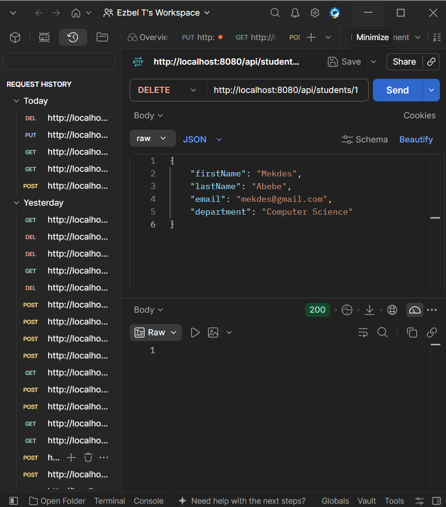

<<<<<<< Updated upstream
# Lab 1: Java JDBC with MySQL

A simple beginner-friendly Java project demonstrating how to connect to a MySQL database using JDBC and perform basic database operations (CRUD).

---

##  What This Program Does

When you run `Main.java`, it automatically does 6 steps:

1. **Creates Database & Table**: Creates a database called `StudentsDB` and a table called `students`.
2. **Inserts Students**: Adds 11 students with their ID, name, and grade.
3. **Displays Data**: Prints the first 5 students to the console.
4. **Updates a Record**: Changes student #1's first name to `"Michael"`.
5. **Deletes a Record**: Removes student #11.
6. **Calculates Average**: Calculates and prints the average grade of the remaining students.

---

##  Requirements

Before running, make sure you have:
- **Java 21** (or Java 17+)
- **MySQL Server** installed and running on your computer (port `3306`)
- **IntelliJ IDEA** (or any Java IDE)

---

##  How to Run

### Step 1: Set your MySQL password

### Step 2: Run the program
=======
# Lab 8 – Spring Boot CRUD Application

## 1. Project Description

The objective of this laboratory is to develop a RESTful CRUD application using Spring Boot and Java.

The application demonstrates how to implement the main CRUD operations (Create, Read, Update, and Delete) using a layered architecture.

## 2. Technologies Used

- Java
- Spring Boot
- Spring Web
- Spring Data JPA
- MySQL
- Maven
- IntelliJ IDEA
- Postman

## 3. Project Structure

The project follows a layered architecture:

- **Model:** Represents the application entities.
- **Repository:** Handles database operations.
- **Service:** Contains business logic.
- **Controller:** Handles HTTP requests and responses.

## 4. CRUD Operations

The application supports the following operations:

| Operation | HTTP Method | Description |
|---|---|---|
| Create | POST | Add a new record |
| Read All | GET | Retrieve all records |
| Read by ID | GET | Retrieve a specific record |
| Update | PUT | Update an existing record |
| Delete | DELETE | Delete a record |

## 5. Screenshots and Evidence

The following screenshots demonstrate the implementation and execution of the application.

### 5.1 Create Operation (POST)

### 5.2 Read All Operation (GET)

### 5.3 Read By ID Operation (GET)

### 5.4 Update Operation (PUT)

### 5.5 Delete Operation (DELETE)

## 6. AI Assistance

ChatGPT was used as an AI learning and development assistant during the implementation of this laboratory.

It assisted with:

- Understanding the laboratory requirements.
- Understanding Spring Boot architecture.
- Implementing CRUD functionality.
- Understanding the Model, Repository, Service, and Controller layers.
- Identifying and resolving programming errors.
- Understanding the implementation step by step.

### ChatGPT Conversation Evidence

[View ChatGPT AI-Assisted Development History](https://chatgpt.com/share/6afeae71-7a30-83ea-af74-c0afc799319b)

## 7. Conclusion

This laboratory provided practical experience in developing RESTful APIs using Spring Boot. It demonstrated the implementation of CRUD operations, layered application architecture, database integration, and GitHub version control.
>>>>>>> Stashed changes
